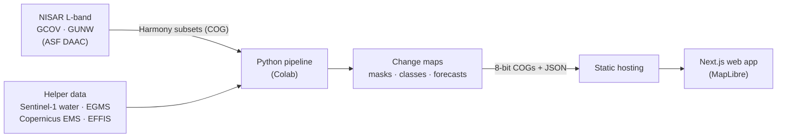

> _**NOTE**: This repository was originally forked from [ilijachrchev/synthetic-aperture-radar](https://github.com/ilijachrchev/synthetic-aperture-radar), but was later detached due to a change in the original repository's visibility..._

<div align="center">

# synthetic-aperture-radar

**Watching Earth's surface flood, grow, burn and sink, seen by NASA-ISRO NISAR radar.**

NASA Space Apps Challenge 2026 · Valencia, Spain · Challenge: [Dancing with the SARs](https://www.spaceappschallenge.org/2026/challenges/dancing-with-the-sars/)

[Challenge brief](docs/INSTRUCTIONS.md) · [Resources](docs/RESOURCES.md) · [Research](docs/RESEARCH.md) · [Models](docs/MODELS.md) · [Data](docs/DATA.md)

</div>

---

## The idea

One web app that shows how the land around Valencia changes, seen by NISAR radar, and what is likely to come next.

| Story | What changes | Where |
|---|---|---|
| Farm water vs storm water | Rice fields flooded on purpose, next to the DANA "Adam" flood of Oct 2026 | Albufera · Pego-Oliva marsh |
| Fire scar | Forest burned in summer 2026 | Serra d'Espadà |
| Sinking ground | Land dropping a few cm a year from groundwater pumping | Lorca |
| Earthquake (global) | Ground moved by the M7.7 quake of 9 Oct 2026 | Panama |

Three models do the work: **CV** finds water, flooded fields and burned ground in each scene, **ML** labels every pixel by how it behaves through the season, and **Prediction** forecasts sinking and flooding with honest ranges. Owners and details: [docs/MODELS.md](docs/MODELS.md).

## What this is

An open-source, interactive web app that turns NISAR L-band radar data into maps and stories anyone can follow.

- **Several kinds of surface change**, not just one.
- **Time series**: every 12-day NISAR pass, not a single before/after snapshot.
- **Predictions with honest uncertainty**: every forecast comes with a range and is scored against a simple baseline.
- **Plain language first**, with the radar details one click deeper.
- **A game** (`/game`): see the marsh on the last pass before the October storm, mark where you think the water will be, and learn from the pass that followed why each cell flooded or stayed dry.

> 🚧 **Work in progress.** Built during the hackathon (13 to 15 Nov 2026). Models and owners: [docs/MODELS.md](docs/MODELS.md). Data facts and sources: [docs/RESEARCH.md](docs/RESEARCH.md).

## Run the prediction baseline

The first implemented component forecasts vertical displacement at Lorca's LOR1 GNSS station, compares persistence, linear trend and annual-seasonal baselines, and exports JSON, scores and charts. This example uses public NGL observations; EGMS CSV ingestion is supported, while NISAR validation remains to be implemented.

```bash
python -m pip install -e ".[dev,prediction]"
python -m pipeline.prediction run
python -m pytest -q
```

Outputs: [`data/prediction/lorca/`](data/prediction/lorca/) and [`data/manifest.json`](data/manifest.json). See the [prediction guide](pipeline/prediction/README.md) for the frozen 14 November example, data cutoffs, backtests, limitations and EGMS import instructions.

## How it works



1. **Fetch:** Harmony cuts each site and the layers we need out of the NISAR files and returns small COGs. A full file is 1 to 7 GB, so we never download whole files.
2. **Process:** calibrate to dB, filter speckle, detect change, classify it, forecast.
3. **Bake:** export small Cloud-Optimized GeoTIFFs (COGs) and JSON.
4. **Show:** the browser reads the COGs directly. No tile server or backend is needed for the demo.

## Stack

| Layer | Tools | Notes |
|---|---|---|
| Web app | Next.js 16 · TypeScript · React 19 | Static export; the map lives in client-only components |
| Maps | MapLibre GL JS 6 · react-map-gl 8 · `@geomatico/maplibre-cog-protocol` | Reads COGs straight from static hosting, no tile server |
| Charts | Recharts (or Observable Plot) | Time series and forecast ranges |
| Data access | Harmony (`harmony-py`) · `earthaccess` · `asf_search` · xarray | Harmony returns site-sized COGs. Each person needs a free [NASA Earthdata login](https://urs.earthdata.nasa.gov/) |
| Geo processing | rasterio · rioxarray · rio-cogeo · geopandas · scikit-image | Runs in Google Colab (Linux), not on our laptops |
| Radar time series | MintPy (reads NISAR GUNW) | Used as an external tool only (GPL-3.0) |
| ML, main | XGBoost / LightGBM · scikit-learn | Per-pixel change classes; CPU, minutes |
| CV, stretch | PyTorch · segmentation-models-pytorch · TorchGeo (Lightning optional) | Small U-Net with Sentinel-1 pretrained encoders; flips/rotations in NumPy (no albumentations: its maintained fork is AGPL) |
| Forecasting | NumPy / statsforecast · MAPIE | Trend + seasonal fits with conformal intervals |
| Backend, optional | FastAPI · TiTiler | Only for dynamic tiles; the demo does not need it |
| Compute | Google Colab / Kaggle (free GPU) | Inference runs offline and exports COGs |
| Hosting | Vercel or GitHub Pages · Hugging Face datasets for large files | All three serve HTTP range requests with CORS |

## Data sources

- **NISAR L2 GCOV** (radar brightness, HH and HV, 20 m) and **GUNW** (12-day ground-motion pairs, 80 m), from NASA's [ASF DAAC](https://nisar-docs.asf.alaska.edu/).
- **OPERA DSWx-S1**: Sentinel-1 surface water maps, used as training labels and for an L-band vs C-band comparison.
- **Copernicus EMS** rapid mapping and **EFFIS**: flood and burnt-area outlines for validation.
- **EGMS** (European Ground Motion Service): years of ground-motion history.
- **USGS** earthquake catalog.

## Repository layout

```
pipeline/        Python package: catalog, labels, context, nisar_fetch, dswx, stack, run, cv/
tests/           checks for every pipeline module (pytest)
data/catalog/    NISAR file lists per site (committed)
data/labels/     flood and burn outlines used to score the models (committed)
data/context/    land cover and water history on the site grids, Lorca GNSS, Panama quake (committed)
data/raw/        downloads: NISAR subsets, water maps, land cover (not committed)
data/stack/      one NetCDF stack per site and track (not committed)
docs/            challenge brief, resources, research, models
web/             Next.js app (to come)
```

## Run the pipeline

Python 3.11 or newer. Commands are for Windows; on macOS or Linux use `.venv/bin/python`.

```bash
python -m venv .venv
.venv\Scripts\python -m pip install -e ".[dev]"
```

Save your free [Earthdata login](https://urs.earthdata.nasa.gov/) once. It asks for your username and password and stores them in a `.netrc` file in your home folder (never in this repo):

```bash
.venv\Scripts\python -c "import earthaccess; earthaccess.login(strategy='interactive', persist=True)"
```

Then build everything the models use (NISAR subsets, water labels, all six stacks) with one command. It skips what is already on disk, so it is safe to re-run:

```bash
.venv\Scripts\python -m pipeline.run
```

Or step by step (each one checks its own output):

```bash
.venv\Scripts\python -m pipeline.catalog --all
.venv\Scripts\python -m pipeline.labels
.venv\Scripts\python -m pipeline.context
.venv\Scripts\python -m pipeline.nisar_fetch --site albufera --stack 066_D_069
.venv\Scripts\python -m pipeline.dswx --site albufera
.venv\Scripts\python -m pipeline.stack --site albufera --stack 066_D_069
.venv\Scripts\python -m pytest -q
```

`catalog`, `labels` and `context` need no login. `nisar_fetch` and `dswx` take `--dry-run` to show what they would download.

## Team

To be added.

## Use of Super Intelligence (SI)

Space Apps asks every team to disclose how SI tools were used.

- Research notes and documentation in this repository were drafted with SI assistance (Claude Code). The Lorca prediction pipeline was developed with OpenAI Codex, and the Albufera forecast, the shared manifest writer and the prediction docs with Claude Code; provider observations remain real data and forecasts are statistical estimates. Facts were checked against primary sources (NASA CMR, USGS, official docs).
- The project idea and all decisions are the team's own.
- SI-assisted commits carry a `Co-Authored-By` trailer. SI-generated images will carry a visible watermark.

## License

To be decided by the team. It will be an open-source license, as the challenge requires. The repository can stay private while we build, but it must be public before we submit: judges must open every link without logging in.

## Acknowledgements

NISAR is a joint mission of NASA and ISRO. Data courtesy of NASA's Alaska Satellite Facility DAAC, NASA JPL OPERA, the Copernicus programme and the USGS. This project is not endorsed by NASA.
 
