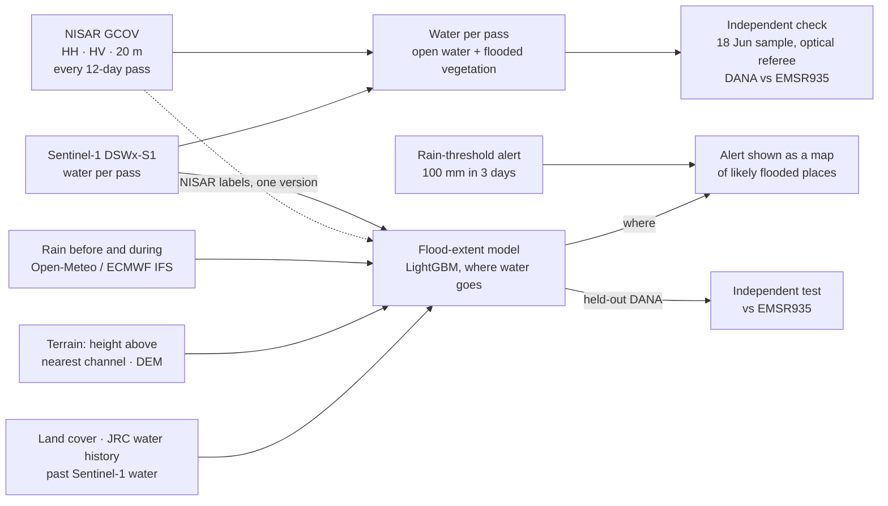

# Where will the water go? Mapping flood extent in Valencia, judged by the first months of NISAR L-band data

**Luka Georgieski, Ilija Chrchev, Zhivko Stoimchev**
NASA Space Apps Challenge 2026, Valencia · challenge "Dancing with the SARs"

*Draft of 15 November 2026, revised after a simulated five-reviewer panel (reports in `docs/paper/review/`) and after a fact-check by I. Chrchev (issue #45). The flood-extent model (PR #33, commit b4c69d9) and its independent test are filled in from their result files. Every measured result in this paper is read from a result file in the repository; `docs/paper/numbers.md` lists each value with its source, and the HTML comments `<!--#key-->` in the Markdown source point to that list. Values taken from documents (warning thresholds, product limits, map scales, mission dates) are cited to those documents, and the few values taken from our code or git history name the file or commit.*

---

## Abstract

A rain alert tells people how much rain will fall; it does not tell them which fields, roads and neighbourhoods will be under water. We ask whether the first months of NASA-ISRO NISAR L-band radar data can help close that gap for the Valencia region. NISAR cannot forecast rain or floods, but it records where water actually is on every 12-day pass, through clouds and, at L-band, partly beneath crops. Our approach is to learn, from radar water maps of many past passes, *where* water collects given rain, terrain and land cover, so that an existing rain alert can be shown as a map of likely flooded places. The model learns from two years of Sentinel-1 water maps; NISAR, with five months of data, is the judge: it checks those labels, it checks the one large flood, and its last map before the storm is a baseline the model must beat. Before using NISAR as a judge, we tested whether it is trustworthy, on the date where NISAR and Sentinel-1 disagree most. On 18 June 2026, inside 14,627.8 ha<!--#june.rice_ha--> of Albufera rice, a −15 dB NISAR threshold mapped 6,387.2 ha<!--#june.nisar_ha--> of water and the Sentinel-1 water product DSWx-S1 249.6 ha<!--#june.s1_ha-->. A stratified sample of 513<!--#june.n_points--> points, fixed in git before scoring and judged by an optical-only referee, gives the NISAR threshold a producer's accuracy of 0.53<!--#v1.nisar.producer--> (95 % interval 0.47 to 0.61<!--#v1.ci95.nisar_producer-->) against 0.02<!--#v1.s1.producer--> for DSWx-S1; where only NISAR sees water, the referee calls 0.83<!--#v1.b_wet_share--> of decided points wet (0.69 to 0.96<!--#v1.ci95.b_user-->), which passes a rule fixed in advance. Two caveats bound this: the optical referee can decide only 30<!--#v1.b_decided--> of the 150 points in that stratum, because the growing canopy hides the water, and a strict open-water referee does not confirm the extra water, so NISAR marks wet ground or water among young plants rather than open water. During DANA "Adam" (18 to 19 October 2026) at Pego-Oliva, 87 %<!--#pego.inside_share--> of 212 ha<!--#pego.new_ha--> of new NISAR water lies inside the official Copernicus EMSR935 flood outline, but neither radar saw the peak: NISAR passed on 16 and 28 October, and Sentinel-1, with 18<!--#pego.s1_passes--> passes from 16 October to 10 November, had none between the evening of 17 October and the morning of 22 October. A flood-extent model (LightGBM, labels from two years of Sentinel-1 water maps, DANA held out) was tested by a team member other than its author against the EMSR935 flood layer, under a rule fixed before the model existed. Replayed with the rain that fell, it reconstructs the flood with F1 0.42 (precision 0.51, recall 0.35)<!--#test.model--> and beats all three baselines: low terrain, past water and the last NISAR map before the storm. With the rain forecast on 17 October instead, it reaches 0.40 (precision 0.54, recall 0.31)<!--#test.model_forecast_rain-->. It also ranks flooded pixels best (average precision: model 0.45, NISAR 16 Oct darkness 0.36, low HAND 0.30, JRC 0.10, base rate 0.02)<!--#test.ap-->. The pass is not robust: two of the margins are within the block-bootstrap uncertainty, and the NISAR map of 16 October with a per-scene threshold scores higher (0.46 (precision 0.51, recall 0.42)<!--#test.nisar_16oct_persistence_otsu-->). Three later frozen versions, run through the same unchanged test, all pass it too (F1 0.425 to 0.465<!--#frozen.f1_range-->), including one that also learns from NISAR labels (0.443<!--#frozen.nisar_labels.f1-->); none ranks flooded pixels better (average precision 0.444 to 0.452<!--#frozen.ap_range-->), so their higher F1 comes from mapping more ground. With only five months of data and one large test event, this is a demonstration of what is possible, not proof; we expect it to improve as NISAR keeps collecting.

---

## 1. Introduction

**Opening: an alert without a map.** Two of the authors were Erasmus students in Valencia in autumn 2026 when the weather service issued yellow, orange and red rain warnings, and they could not tell what any of them meant for their own street. The region has reason to take such warnings seriously: the DANA of 29 October 2024 caused catastrophic flash floods in the province of Valencia, with €17.8 billion of material damage [France 24 2025]. A rain warning answers "how much rain, where, when": in the Valencia warning zones, yellow, orange and red mean at least 60, 100 and 180 mm in 12 hours [AEMET Meteoalerta]. A phone alert can tell residents to stay away from flood-prone areas, but not which areas those are. Neither answers the question a resident actually has: "will *my* road, field or neighbourhood flood?" The gap between a rain total and a flooded place is the subject of this paper. This first version covers rice fields and the marsh, where radar sees water well; in towns, where it does not, the map must mark streets as *not assessed* rather than dry (Section 6.2).

**The forecast is only half of the problem; the footprint is the other half.** Numerical weather prediction often sees large storms coming, but not steadily. In our replay of the October 2026 DANA, the ECMWF IFS 9 km run of 13 October put 158.2 / 69.2 mm<!--#alert.run13_daily_18_19--> of rain on 18 and 19 October at the wettest grid point over Pego-Oliva, five days ahead; the later runs gave 64.0 / 20.8 mm<!--#alert.run14_daily_18_19--> (14 October), 68.9 / 55.7 mm<!--#alert.run15_daily_18_19--> (15 October), 79.3 / 128.8 mm<!--#alert.run16_daily_18_19--> (16 October) and 41.2 / 21.3 mm<!--#alert.run17_daily_18_19--> (17 October), against 64.9 / 94.4 mm<!--#rain.fell_18_19--> in the IFS archive for those days (`pipeline/prediction/flood/early_runs.py`, `forecast.json`, `rain_pego_oliva.csv`; Section 5.5), and our rain trigger never reached red. Satellites cannot fix that: no radar predicts rain. And even a perfect rain forecast leaves open where the water goes. What is missing is a link from rain to flooded ground, which depends on terrain, drainage, land cover and how wet the soil already is. Hydraulic models provide that link where they have been built and calibrated, but they need river geometry, defences and inflow data that many small Mediterranean catchments do not have.

**Learning the footprint from observed water needs many honest water maps.** A data-driven alternative is to learn, from many past events, where water appears after a given rain. The bottleneck is labels: one needs a reliable water map for every pass, including under vegetation and through clouds. Optical images are blocked by the clouds that come with storms. C-band radar (Sentinel-1) sees through clouds but loses water beneath crops and marsh vegetation, and the operational DSWx-S1 product maps inundated vegetation only where its land-cover layer says "wetland" [OPERA DSWx-S1]. L-band radar penetrates further into vegetation [NASA Earthdata SAR], and NISAR is the first mission to provide free, systematic L-band coverage on an exact 12-day repeat [NISAR Handbook; ASF NISAR docs]. Learning flood extent from satellite water maps is not new in itself: Google's operational system learns a wet/dry threshold per pixel from Sentinel-1 flood maps paired with river stage [Nevo et al. 2022], and Dasgupta et al. [2022] trained a neural network on Sentinel-1 flood maps with rain, soil moisture and terrain as inputs. Both learn from C-band labels, which miss most water beneath vegetation. NISAR could supply better labels, but its calibrated public data only begin with acquisitions of 17 June 2026, its official water product (OPERA DSWx-NI) is still under development [OPERA DSWx suite], and no independent check of its water maps over Spain existed.

**Our approach: NISAR as the judge.** The model learns the mapping from rain, terrain (height above the nearest channel), land cover and water history to observed water from two years of Sentinel-1 water maps (413 passes per site), because NISAR's five months, about a dozen passes per track, are too few to train on alone. NISAR, the newest radar in orbit, then plays the judge in three ways: (1) it checks the Sentinel-1 labels on the date the two radars disagree most and shows what they miss under young crops; (2) it checks the one large flood against the official outline; (3) its last map before the storm is a baseline the model must beat. The model itself is judged by the Copernicus EMSR935 flood map, not by NISAR. A later version that also learns from NISAR water was frozen and run through the same test (Section 5.6). The trained model turns an existing rain alert into a map of likely flooded places. The first users we have in mind are people who live, farm or drive near the rice fields and the marsh, and local civil protection, who need to know which low fields and roads to watch when a warning comes. Because the labels drive everything, we first test them: an independent, pre-registered, sample-based accuracy assessment of NISAR water against Sentinel-1 on a date where the two disagree most.

**Contributions.**
1. **An independent, pre-registered check of early NISAR water maps.** On 18 June 2026 in the Albufera rice, a simple NISAR threshold finds about half of the water an optical referee calls wet (producer's accuracy 0.53<!--#v1.nisar.producer-->), where the DSWx-S1 product finds 0.02<!--#v1.s1.producer-->. Sample points and the pass rule were committed to git before scoring. We also report what goes against us: the referee can decide few points, and a strict open-water referee does not confirm the extra NISAR water.
2. **An event check against an official flood outline.** For DANA "Adam", 87 %<!--#pego.inside_share--> of new NISAR water lies inside the Copernicus EMSR935 outline; we also show why NISAR's sparse sampling missed the peak.
3. **A flood-extent model and its independent test** on the held-out DANA, run by a team member other than the model's author under a rule fixed before the model existed. The model passes (F1 0.42 (precision 0.51, recall 0.35)<!--#test.model--> against at most 0.29 for the three baselines, in a replay with the rain that fell; 0.40 with the forecast rain) but not robustly (Section 5.6).
4. **Open code and data** with every number traceable to a result file, plus a plain statement of what five months of data can and cannot show.

---

## 2. Background and related work

**SAR water mapping and the vegetation problem.** Calm open water reflects radar away from the sensor and appears dark, so water is commonly mapped by thresholding backscatter, often with a per-scene threshold such as Otsu's method. Vegetation standing in water behaves differently: the wave bounces off the water surface and then off stems back to the sensor ("double bounce"), so flooded vegetation can appear *brighter* than dry vegetation in co-polarised HH [NASA Earthdata SAR], while the effect is weaker in cross-polarised HV [Tsyganskaya et al. 2018]. Longer wavelengths reach the water beneath a canopy more often, which is why L-band is preferred for flooded forest and marsh [NASA Earthdata SAR]. C-band missions such as Sentinel-1 provide frequent, free data but see water under young crops less reliably. Over rice, the signal changes with the crop stage: young, sparse plants in water look dark, and as the stems grow the wave bounces between water and stems and HH becomes bright [Le Toan et al. 1997]; L-band follows this cycle well [Rosenqvist 1999]. Reviews and case studies of flooded-vegetation detection describe the same two mechanisms, dark open water where vegetation is sparse and bright double bounce where stems stand in water [Tsyganskaya et al. 2018]. A single dark threshold sees only the first. Built-up areas are hard for every SAR: walls and ground form double-bounce corners, and layover and shadow hide streets, so urban flood mapping from SAR remains an open problem [Mason et al. 2010].

**Operational water and flood products.** NASA's OPERA project publishes DSWx-S1, a 30 m Sentinel-1 water map with classes for open water and inundated vegetation; by design the inundated-vegetation class is only issued where the ancillary land cover is wetland [OPERA DSWx-S1], and the product targets water bodies larger than about 3 ha and 200 m wide [OPERA DSWx-S1]. The NISAR version, DSWx-NI, is listed as under development [OPERA DSWx suite]. Copernicus Global Flood Monitoring (GFM) maps floods automatically on every Sentinel-1 scene in VV polarisation since 2015; its authors name L-band as future work [Wagner et al. 2026]. Copernicus Emergency Management Service (EMS) rapid mapping delivers analyst-checked flood outlines for major events, such as EMSR935 for DANA "Adam" [Copernicus EMS EMSR935]. These products are excellent references for single events but do not, on their own, predict where a future storm's water will go.

**Official flood zones and river forecasts.** Spain's national flood-zone system SNCZI maps official zones for 10-, 50-, 100- and 500-year floods at 1:25,000, but along only part of the river network [SNCZI]. The Valencian plan PATRICOVA maps six hazard levels plus a geomorphological level for land that is flood-prone by its landform [PATRICOVA]. These are the legal reference for planning and should stay so; they show the same map whatever the forecast. River forecasting systems such as Copernicus EFAS/GloFAS and Google Flood Hub forecast river flow days ahead and pair it with inundation maps, but EFAS hazard maps cover river floods on catchments above 150 km² and leave out rain-fed (pluvial) flooding [CEMS-Flood maps; Nevo et al. 2022]. The official zones can be right: of the 963.2 ha<!--#zones.pego_flooded_ha--> that EMSR935 saw flooded or marked with flood traces in Pego and Oliva during DANA "Adam", 95.3 %<!--#zones.pego_freq_occ--> lay in the frequent or occasional SNCZI zones and 0.2 %<!--#zones.pego_outside--> outside every zone (`data/zones/zones_vs_floods.json`, I. Chrchev). What none of these tools gives is a map tied to the next storm: the zones show the same map whatever the forecast, and the river systems leave out rain falling directly on fields such as the Albufera rice.

**Where water goes: terrain and learned susceptibility.** Terrain descriptors such as Height Above the Nearest Drainage (HAND) explain much of where floods can occur [Nobre et al. 2011], and long records of surface water such as the JRC Global Surface Water dataset show where water has been before [Pekel et al. 2016]. Machine-learning flood-susceptibility maps combine such static factors, but they are usually trained on a handful of mapped events and do not condition on the rain of a specific storm. Closest to our approach, Nevo et al. [2022] learn per-pixel flood thresholds from Sentinel-1 water maps paired with river stage, and research models condition a neural network on rain and soil moisture with Sentinel-1 flood maps as labels. Our setting differs in three ways: NISAR L-band water checks the labels and is a baseline the model must beat (the tested model learns from Sentinel-1 labels, Section 4.4), the driver is forecast rain from a global weather model rather than river stage, and the test rule is fixed before the model exists (Table 1).

*Table 1. What exists and what this work adds.*

| | Input that drives the map | Water labels | Covers small coastal wetlands | Tied to a rain warning |
|---|---|---|---|---|
| SNCZI, PATRICOVA (official zones) | Return period (hydraulic model, landform) | none (modelled) | partly | no |
| EFAS / GloFAS hazard maps | Forecast river flow | none (modelled) | no (rivers > 150 km² catchment) | no |
| Google Flood Hub, inundation [Nevo et al. 2022] | River stage | Sentinel-1 (C-band) | no (gauged rivers) | no |
| Dasgupta et al. [2022] | Rain, soil moisture, terrain | Sentinel-1 (C-band) | not tested here | no |
| Copernicus GFM, OPERA DSWx-S1 | none (observation only) | Sentinel-1 (C-band) | open water only | no |
| **This work** | **Rain before and during the event, terrain, land cover, past water, last water map** | **Sentinel-1 (C-band), checked with NISAR (L-band); NISAR labels in a variant** | **study sites only** | **yes, to our forecast-rain trigger (the map is shown when it fires), not to the public AEMET warning** |

**Honest accuracy assessment.** Accuracy and area estimates from maps are biased when checked on convenience samples or against another map. Olofsson et al. [2014] set out good practice: a probability sample stratified by map class, stratum-weighted estimators of user's and producer's accuracy, and confidence intervals. For classifiers on rasters, spatially blocked validation avoids optimistic scores from neighbouring pixels. We follow both.

---

## 3. Study area and data

### 3.1 Sites

We work at three sites around Valencia (Spain):

- **Albufera de València**, a coastal lagoon surrounded by about 14,790.6 ha<!--#alb.rice_mask_ha--> of rice (CORINE 2018 class 213). The paddies are flooded on purpose from sowing in May to drainage in August and again in winter, so "water" here is often farm water, not a flood.
- **Pego-Oliva marsh**, south of Valencia, flooded by DANA "Adam" on 18 to 19 October 2026 and mapped by Copernicus EMS (EMSR935).
- **Serra d'Espadà** (Castellón), used only for the land-class model (a summer 2026 wildfire).

### 3.2 NISAR data and its maturity

NISAR, a joint NASA-ISRO L-band (wavelength about 24 cm) and S-band SAR, launched on 30 July 2025 [ASF NISAR docs]. Table 2 summarises the public data available to us. All NISAR data used here are PROVISIONAL or VALIDATED; BETA data were not used.

*Table 2. NISAR data maturity and products used (ASF NISAR documentation, accessed 14 Nov 2026).*

| Item | Value |
|---|---|
| Launch | 30 Jul 2025 |
| BETA (not calibrated; not used) | Released 23 Jan and 27 Feb 2026; subset of acquisitions 17 Oct 2025 to 20 Jan 2026 |
| PROVISIONAL | Released 20 Jul 2026; acquisitions from 17 Jun 2026 to 21 to 23 Oct 2026 (ASF and the CMR catalogue differ slightly on the end date) |
| VALIDATED (L0 to L2) | Released 6 Nov 2026; acquisitions from 21 Oct 2026 on |
| Permanent data gap | 27 Jul to 10 Aug 2026 |
| GCOV (backscatter) | HH and HV, 20 m, map-projected, linear power |
| GUNW (interferograms) | Unwrapped phase and coherence at 80 m |
| SME2 (soil moisture) | 200 m, PROVISIONAL only, "not fully calibrated", withheld or flagged over dense vegetation |
| Repeat | 12 days per track |

At Albufera we use two GCOV tracks, 066 D (evening) and 058 A (morning), each reprojected once onto a common 20 m grid (EPSG:32630) after a 5 × 5 speckle filter in linear power. Pego-Oliva is observed by track 066 D on 16 and 28 October 2026, either side of the DANA. The 16 → 28 October pair mixes PROVISIONAL and VALIDATED processing; ASF advises caution when mixing maturity levels in one analysis [ASF NISAR docs]. On stable urban pixels the team measured a shift of only −0.10 to −0.34 dB in HH into the VALIDATED date, inside the normal 12-day changes of up to 0.63 dB (`docs/DATA.md`).

### 3.3 Reference and auxiliary data

- **DSWx-S1** (OPERA, 30 m), with a pass within about 1 h of NISAR at Albufera on 18 June (17:54 UTC vs 18:53 UTC<!--#june.nisar_utc-->).
- **Optical images** for the independent referee: Sentinel-2 L2A on 8 June and 23 June, Landsat 9 on 22 June 2026. The only image on 18 June itself was fully clouded over the rice.
- **Copernicus EMSR935** flood outline (imagery of 20 to 21 October) and the Generalitat Valenciana river-flood footprint for DANA "Adam".
- **Rain**: ECMWF IFS 9 km forecasts and archive via Open-Meteo.
- **Labels for the land-class model**: ESA WorldCover, JRC Global Surface Water occurrence, CORINE 2018, EFFIS burnt area and hand-drawn rice fields.

---

## 4. Method

### 4.1 Overview

Figure 1 shows the pipeline. NISAR provides one water map per pass (4.2), which we use as a judge: an independent check measures how right NISAR and the Sentinel-1 labels are where the two radars disagree most (4.3). The flood-extent model learns where water appears from Sentinel-1 water, rain and terrain (4.4) and is tested on the held-out DANA against EMSR935 under a test fixed before the model exists (4.5). An existing rain alert (4.6) chooses *when* to show the map; the model chooses *where*.

*Figure 1. Pipeline. Solid arrows: the first tested model. Dashed: NISAR labels, used in one later frozen version, also tested against EMSR935 (Section 5.6).*

### 4.2 Water from each NISAR pass

**Motivation.** To judge the Sentinel-1 labels, we need one NISAR water map per pass that does not depend on the C-band products it is compared with. **Design.** Open water is a pixel whose 5 × 5-filtered HH is below −15.0 dB<!--#june.threshold_db-->. The threshold was fixed before any comparison (the fallback of our land-class pipeline), and was later confirmed on the second Albufera track, which played no part in choosing it: across 10<!--#alb.058.paired--> paired dates on track 058 A, NISAR's dark share of the rice and DSWx-S1's flooded share correlate at r = 0.978<!--#alb.058.r15-->. The labels for the flood-extent model add a flooded-vegetation class, where HH rises by about 3 dB between passes while HV stays flat (double bounce), and merge NISAR with Sentinel-1 water on each pass (work by I. Chrchev). The model tested in Section 5.6 does not use these labels: its labels are Sentinel-1 water maps, and NISAR open water enters only in a variant (Section 4.4). The flooded-vegetation class is not used in any result of this paper and has not been checked yet. On 18 June the median rice backscatter was −14.41 dB<!--#alb.066.jun18_median-->, almost at the threshold, so the mapped area on that date is sensitive to it: 54.5 / 32.2 %<!--#alb.066.jun18_dark_14_16--> of the rice is darker than −14 / −16 dB. At Pego-Oliva (Section 5.3) the event check reuses the team's CV baseline, a per-scene Otsu threshold (−11.85 / −12.03<!--#pego.otsu_db--> dB before / after), not the fixed −15 dB. **Advantage.** L-band reaches water beneath young crops more often than C-band; Section 5.1 tests whether this is true here.

### 4.3 Independent check of NISAR water on 18 June 2026

**Motivation.** On 18 June 2026 the two radars disagree most: inside the scored rice, NISAR (066 D) maps 6,387.2 ha<!--#june.nisar_ha--> of water and DSWx-S1 249.6 ha<!--#june.s1_ha-->. If NISAR is right, it sees water that C-band misses; if wrong, it would poison the labels. A third map, the web app's U-Net water layer, was trained on DSWx-S1 labels and is scored on the same points.

**Design: sample.** Following Olofsson et al. [2014], rice pixels are split into four strata by the two radar maps: A both say water, B NISAR only, C Sentinel-1 only, D neither; stratum E is non-rice cropland (WorldCover class 40), a control that should be dry. Candidates lie on a 200<!--#june.grid_m--> m grid with a random offset, so no two points are neighbours, and points are drawn at random per stratum with a fixed seed (Table 3). The 513<!--#june.n_points--> points were committed to git (commit `682d951`) before any scoring.

*Table 3. Strata, area and sample size.*

| Stratum | Meaning | Area (ha) | Points |
|---|---|---:|---:|
| A | both maps say water | 116.2<!--#june.ha_A--> | 25<!--#june.n_A--> |
| B | NISAR only | 6,271.0<!--#june.ha_B--> | 150<!--#june.n_B--> |
| C | Sentinel-1 only | 133.4<!--#june.ha_C--> | 38<!--#june.n_C--> |
| D | neither (rice) | 8,107.2<!--#june.ha_D--> | 150<!--#june.n_D--> |
| E | control, non-rice cropland | 5,661.2<!--#june.ha_E--> | 150<!--#june.n_E--> |

**Design: referee.** The referee uses no radar data, so it does not share the radar's errors; it can still share causes with the radar, such as the crop stage (Section 5.1). A point is wet on an optical date when the rice-flooding signal holds, LSWI + 0.05 ≥ EVI [Xiao et al. 2005], or MNDWI > 0. Because 18 June itself is clouded, the label brackets the date: *wet* if wet on 8 June (Sentinel-2, 10 days before) **and** on the closest clear look after (Landsat 9, 22 June; Sentinel-2, 23 June where Landsat is cloudy), *dry* if dry on both, otherwise *unclear*. Unclear points are not imputed: we report the estimate from decided points and the worst-to-best range obtained by setting each unclear point wet or dry, whichever lowers or raises the score. A strict variant uses MNDWI > 0 alone, the open-water signal, which wet mud trips less often.

**Design: scoring and pre-registered rule.** User's and producer's accuracy are stratum-weighted (weight = stratum share of the rice) over decided points, with 95 % intervals from a stratified bootstrap (2,000 resamples). The pass rule was posted on GitHub Discussion #25 before the first score: NISAR "wins" if its user's accuracy in stratum B is at least 0.7<!--#rule.min_share--> and the lower end of its 95 % interval is at least 0.6<!--#rule.min_ci_low-->. **Which referee is pre-registered.** The pass rule and referee v1 (Sentinel-2 on 8 and 23 June) were in place before the first score (commit `54fdc99`), so v1 is the primary result. After seeing v1 and a team review, we wrote referee v2, which takes the closest clear look after 18 June (Landsat 9, 22 June). v2 was committed (`e5a2d30`) before it was run (`de3e9f8`), but because it was written after v1 was seen, we report it as a sensitivity analysis, not as a pre-registered test. The pass rule did not change.

### 4.4 Flood-extent model

**Motivation.** The rain alert says *when*; the model is meant to say *where*. **Design.** The model, built by Z. Stoimchev (PR #33, commit b4c69d9<!--#test.commit-->), is a LightGBM classifier [Ke et al. 2017] that scores every 20 m land pixel of Albufera and Pego-Oliva for water on a target Sentinel-1 pass. Its inputs are terrain (height above the nearest drainage from the GLO-30 HAND, elevation, slope), land cover (WorldCover, the Albufera rice mask), past water (JRC occurrence and the share of earlier Sentinel-1 passes that saw water), the water map of the issue pass (the latest pass at least three days before the target) and site rain from the IFS archive, split into rain before the issue day and rain between issue and target. Its labels are OPERA DSWx-S1 water maps, 413 passes per site from August 2024; NISAR does not enter the exported model. Variants add NISAR SME2 soil moisture, the team's NISAR open-water labels, or both; in PR #33 they are scored only against held-out Sentinel-1 passes and export no maps; three versions frozen later (PR #46), one of them with NISAR labels, export maps and are tested in Section 5.6. The window 15 October to 15 November 2026 is held out of every fit, threshold and past-water share. The development check fits on targets before 1 September 2025 on training blocks and checks on later targets on held-back 1 km blocks; the number of trees and the decision thresholds come from that check and are then frozen. **Retrospective check (the author's).** On the held-out October passes at Pego-Oliva, scored against Sentinel-1, the full model ranks water better than terrain alone (water AP 0.64 vs 0.56 terrain only<!--#model.holdout_pego-->); on the two storm passes, NISAR labels raise the new-water score slightly at Pego-Oliva (0.45 (base) vs 0.49 (NISAR labels)<!--#model.storm_new_ap-->) but lower it at Albufera (0.65 (base) vs 0.58 (NISAR labels)<!--#model.storm_new_ap_albufera-->), and the model hardly uses soil moisture (0.09 %<!--#model.soil_gain_share--> of the gain). **Output.** A relative likelihood of water per pixel, not depth, speed or arrival time.

> **Requirements for the residents' map** (from the review, fixed now): (1) three states, never two: *likely wet*, *no signal* (and the line "areas without colour can still flood"), and *not assessed* for built-up areas, where the labels are unreliable; (2) the map is triggered by the official AEMET warning level, not by a separate colour scheme of our own (the alert of Section 4.6 is a research baseline, not a public warning); (3) the official PATRICOVA / SNCZI zones are shown next to it as the legal reference.

### 4.5 Independent test against EMSR935 (fixed before the model exists)

**Motivation.** A model tuned and scored by the same people on the same event proves little. This test is written down before the model is available and is run by a different team member (L. Georgieski) than the model's author. **Design.** The DANA "Adam" window (15 October to 15 November 2026) is held out of training. The model is given the rain of the event and maps likely flooded pixels at Pego-Oliva: a reconstruction with known rain, not a forecast. The reference is the *observed* flood layer of Copernicus EMSR935, area of interest 01, which covers the Pego-Oliva marsh and was mapped from imagery of 20 to 21 October [Copernicus EMS EMSR935]. Its *modelled* layer (water pushed along low ground into areas the image could not see) is scored separately, and its "not analysed" areas are masked. We report precision (share of predicted flooded area inside the observed flood), recall (share of the observed flood predicted) and F1, plus the same scores for three baselines: (i) low terrain only (lowest height above the nearest channel, same flooded area as the model); (ii) past water only (JRC occurrence > 0); (iii) persistence, the NISAR water of the last pass before the event (16 October). As context, not part of the rule, we also report how much of the observed flood lies inside the official PATRICOVA hazard zone and the SNCZI 500-year zone. **Rule.** The model is said to add value if its F1 beats all three baselines; otherwise we report that it does not. *(This test was first written with baselines (i) to (ii) and the whole EMSR935 outline; on 14 November 2026, still before the model existed, it was tightened to add baseline (iii) and the observed/modelled split after a review of existing work. Both versions are in the git history.)* **How it was run, and what changed.** The test script (`pipeline/validation/emsr935_test.py`) was committed before the first score. The model under test is the exported `base` model, replay of 22 October (issued from the Sentinel-1 pass of 17 October, with the rain that fell), the pass closest to the EMSR935 imagery; "likely flooded" is a likelihood at or above the model's frozen threshold of 0.284<!--#test.threshold-->. The published EMSR935 data (Copernicus via the Valencian cartographic institute) do not have the observed / modelled split or a "not analysed" mask assumed above; they have *flooded area* (semi-automatic extraction from the image) and *flood trace* (photo-interpretation of where water had been). We therefore score against *flooded area* and report *flooded area + flood trace* apart, over the whole of AOI01 inside our grid: 39,091 ha<!--#test.area_ha--> of land, without permanent water, where NISAR had a valid pixel on 16 October. Persistence uses the paper's general NISAR water rule (−15 dB, Section 4.2). The F1 rule was committed before the first model commit (paper commit 557e3fd, 23:55 on 14 November; model commit 74ba6f8, 00:42 on 15 November). The reference layer and the Otsu threshold for persistence (a sensitivity) were set in the test script after the model existed but before its first score (commit 1559091). Two things were added after the first run and are stated as such: (1) 6.4 %<!--#test.hand0_share--> of the scored land (2,491 ha<!--#test.hand0_ha-->, far more than the area the model maps) has HAND exactly 0, so the first run filled the low-terrain quota with tied pixels in map order and scored F1 0.034 (commit e0bf136); ties are now broken at random (F1 over 50 draws 0.236 to 0.249<!--#test.low_hand_draws-->), and the model beats the low-terrain baseline either way; (2) average precision, a score that does not depend on how much area a method maps. Uncertainty: 1,000 bootstrap resamples of 1 km blocks. PATRICOVA is published as open data [PATRICOVA] but was not compared here; the SNCZI comparison is in `data/zones/zones_vs_floods.json` (I. Chrchev): 95.3 %<!--#zones.pego_freq_occ--> of the flooded and flood-trace area in Pego and Oliva lay in the frequent or occasional zones (Section 2).

### 4.6 Rain trigger (when): a research baseline, not a public warning

The rain trigger, built by Z. Stoimchev, is a research baseline, not a public warning: the public warning level always remains AEMET's (showing it in the app is planned, not yet built). It is a traffic light per site from the largest 3-day rain total in the first three days of the deterministic ECMWF IFS 9 km run: red at ≥ 100<!--#alert.threshold_mm--> mm, amber at ≥ 50 mm. The 100 mm threshold is a published anchor for flash floods in Valencian ephemeral streams [Camarasa-Belmonte 2016], a rain-gauge total that we apply at a 9 km grid point, fixed before our data were examined. Fitting a threshold on our own data failed. Training (August 2024 to October 2026 minus the DANA) holds only 4 new-flood events in 504 passes; the published threshold caught 1 of them with 16 false alarms<!--#alert.train-->, and the best-fit threshold came out at 7<!--#alert.fitted_mm--> mm with 218<!--#alert.fitted_train_fa--> false alarms. The DANA window was held out as the test.

### 4.7 Land-class model (context layer)

A per-pixel LightGBM classifier [Ke et al. 2017] (by L. Georgieski) labels land as rice, permanent water, urban, forest, burned, other crops and shrub, or orchard from the NISAR time series of both tracks (62 features: per-track HH and HV statistics through the season, timing and size of the largest drops and rises, and 5 × 5 texture). It is trained and scored on separate 1 km blocks, with a second block split inside the training area used for every design choice and the test blocks looked at once. Labels come from WorldCover, JRC, CORINE, EFFIS and hand-drawn fields, so scores measure agreement with these maps, not ground truth. Its class map is a candidate land-cover feature for the flood-extent model.

### 4.8 From result files to the app

**Motivation.** A map helps residents only if they can open it on a phone and see where each number comes from. **Design.** The pipeline runs in four steps (Fig. 1): *fetch* small site subsets of the NISAR files through NASA Harmony (a full file is 1 to 7 GB, so whole files are never downloaded); *process* them (calibration to dB, speckle filter, water, classes, forecasts); *bake* the results into small Cloud-Optimized GeoTIFFs and JSON; and *show* them in a Next.js web app whose MapLibre map reads those files directly from static hosting, with no tile server or backend. The app (live demo: https://dancing-with-the-sars-liard.vercel.app) has story pages for the flood, the rice fields and the fire; `/explore`, a map of the measured water depths of 2024 and a simulated run; `/views`, four views of what only NISAR gives (a swipe between the Sentinel-1 and NISAR water maps of the same evening, coherence, NISAR soil moisture before the DANA, and NISAR water on every pass); and `/game`, which replays DANA "Adam" at Pego-Oliva: the player sees the last NISAR pass before the storm and the rain forecast, marks ten cells where water will come, and is scored against the pass after the storm, with each cell explained from the measurements. **Technical advantage.** Each baked layer carries the files its numbers come from, the same rule this paper follows (Section 7), and a residents' map following the three-state rules of Section 4.4 is planned, not yet in the app.

---

## 5. Results

### 5.1 NISAR sees water on 18 June that Sentinel-1 does not

**Main result.** Under the pre-registered referee (v1), the NISAR threshold finds about half of the rice the referee calls wet (producer's accuracy 0.53<!--#v1.nisar.producer-->, 95 % interval 0.47 to 0.61<!--#v1.ci95.nisar_producer-->), while DSWx-S1 finds 0.02<!--#v1.s1.producer--> (Table 4, Fig. 2). Referee v2 gives the same picture. The app's U-Net, trained on DSWx-S1 labels, holds only 167<!--#june.unet_ha_all--> ha of water in the rice on that date: it inherits the C-band blind spot. Two comparisons keep this in proportion. First, the rice was mostly wet anyway: about 10,023<!--#v1.wet_rice_ha--> ha (95 % interval 8,548 to 11,379<!--#v1.wet_rice_ha_ci--> ha) under v1, so a random map of NISAR's size would already reach a producer's accuracy of 0.44<!--#june.nisar_area_share-->. NISAR does better, but the margin is modest. Second, the comparison is between a simple NISAR threshold and the DSWx-S1 *product*, whose rules leave out inundated vegetation outside wetlands and small water bodies (Section 6.2); it is not a test of C-band physics.

*Table 4. Accuracy on 18 June 2026. v1 = pre-registered referee (8 and 23 June); v2 = sensitivity analysis (8 and 22 June). Estimates from decided points; worst to best: every unclear point set to the case that lowers or raises the score. Higher is better.*

| Map | Producer's, v1 (95 % CI) ↑ | Producer's, v2 (95 % CI) ↑ | Producer's worst to best, v2 | User's, v1 ↑ | User's, v2 ↑ |
|---|---:|---:|---:|---:|---:|
| NISAR threshold (−15 dB) | **0.53**<!--#v1.nisar.producer--> (0.47 to 0.61<!--#v1.ci95.nisar_producer-->) | **0.52**<!--#v2.nisar.producer--> (0.48 to 0.57<!--#v2.ci95.nisar_producer-->) | 0.22 to 0.71<!--#v2.nisar.range_producer--> | 0.84<!--#v1.nisar.user--> | 0.94<!--#v2.nisar.user--> |
| DSWx-S1 (Sentinel-1 product) | 0.02<!--#v1.s1.producer--> (0.02 to 0.03<!--#v1.ci95.s1_producer-->) | 0.02<!--#v2.s1.producer--> (0.02 to 0.02<!--#v2.ci95.s1_producer-->) | 0.01 to 0.05<!--#v2.s1.range_producer--> | 0.91<!--#v1.s1.user--> | 0.92<!--#v2.s1.user--> |
| App U-Net (trained on DSWx-S1) | 0.07<!--#v1.unet.producer--> (n/a) | 0.04<!--#v2.unet.producer--> (0.00 to 0.08<!--#v2.ci95.unet_producer-->) | 0.01 to 0.04<!--#v2.unet.range_producer--> | 1.00<!--#v1.unet.user--> | 1.00<!--#v2.unet.user--> |
| *Random map, same area as NISAR (reference)* | *0.44*<!--#june.nisar_area_share--> | *0.44* | n/a | n/a | n/a |

*Figure 2. Accuracy of three water maps on 18 June 2026 (referee v2). (a) Producer's accuracy: how much of the wet rice each map finds. (b) User's accuracy: how much of each map's water is really wet. Dark dot: estimate from decided points; mid-blue and light-blue dots: lower and upper end of the 95 % interval (stratified bootstrap); where the dots overlap, the interval is narrow. Worst and best cases for the unclear points are in Table 4. Data: `docs/paper/figure-data/``fig2a_producers_accuracy.csv`, `fig2b_users_accuracy.csv`, from `data/validation/june18/result.json`.*

*Figure 3. Referee outcome per stratum, as counts of sample points: (a) referee v2, (b) the strict open-water referee on the same points. The bold number is the number of points in the stratum. Data: `docs/paper/figure-data/``fig3a_strata_referee_v2.csv`, `fig3b_strata_strict.csv`, from `result.json`.*

*Figure 4. Left: where the two radar maps agree and disagree inside the Albufera rice on 18 June 2026 (20 m grid, UTM 30N). Right: the sample points coloured by referee v2; points outside the rice are the control stratum E.*

**Pre-registered rule: passed, on few decided points.** In stratum B, where only NISAR sees water, referee v1 gives 25 wet / 5 dry / 120 unclear<!--#v1.counts_B--> points: 0.83<!--#v1.b_wet_share--> of the decided points are wet (interval 0.69 to 0.96<!--#v1.ci95.b_user-->), so both parts of the rule (≥ 0.7, lower bound ≥ 0.6) hold (Fig. 3). Under v2: 46 wet / 3 dry / 101 unclear<!--#v2.counts_B-->, a share of 0.94<!--#v2.b_wet_share--> (0.86 to 1.00<!--#v2.ci95.b_user-->). Stratum B is wetter than stratum D, where neither map sees water (0.56<!--#v1.d_wet_share--> under v1, 0.68<!--#v2.d_wet_share--> under v2), so the extra NISAR water is not simply where the rice was wet anyway. The control stratum E stays dry (2.9 %<!--#v2.control_E--> wet under v2). The pass rests on decided points only: for the rule to hold on all 150 B points, at least 80 of 120<!--#v1.b_tipping--> unclear points would have to be wet under v1 (59 of 101<!--#v2.b_tipping--> under v2). Most B points are unclear because the canopy grew between 8 June (median NDVI 0.34<!--#optical.ndvi_2026-06-08-->) and 22 June (0.59<!--#optical.ndvi_2026-06-22-->) and hid the water, and they are not random: 95 of 101<!--#v2.b_unclear_wet_then_dry--> unclear B points are wet before and dry after. If each unclear point took its worst or best case, NISAR's producer's accuracy could lie anywhere in 0.22 to 0.71<!--#v2.nisar.range_producer-->, against 0.01 to 0.05<!--#v2.s1.range_producer--> for DSWx-S1: the ranking holds, the size of the gap does not (Table 4).

**The result that goes against us: not open water.** Under the strict referee (MNDWI > 0 only), stratum B has 3 wet / 26 dry / 121 unclear<!--#strict.counts_B--> points, a share of 0.10<!--#strict.b_wet_share--> (interval 0.00 to 0.23<!--#strict.ci95.b_user-->), and NISAR fails the rule. The extra NISAR water is therefore wet according to the rice-flooding index but not open water seen from above. Three explanations fit: a short drainage between the optical looks, water beneath young rice plants (which L-band can reach and the optical open-water index cannot), or soaked mud, which darkens radar and can trip LSWI. Optical data cannot separate them. Under this referee, stratum B is also no wetter than stratum D (10 wet / 75 dry / 65 unclear<!--#strict.counts_D-->), which fits a common cause, the crop stage, behind both the dark radar signal and the optical index. For flood mapping the practical reading is that NISAR at −15 dB marks *wet ground and shallow water among plants*, a useful but broader class than open flood water; and because the June median sits almost at the threshold (Section 4.2), a threshold sweep on the fixed sample points is the next check.

**The threshold does not drive the result.** Because the June median sits near −15 dB, we repeated the scoring on the same fixed points for thresholds from −13 to −18 dB (`pipeline/validation/june18_sweep.py`; Table 5). The share of the rice the NISAR map calls water falls from 0.61<!--#sweep.13.mapped--> to 0.10<!--#sweep.18.mapped-->, and its producer's accuracy falls with it, but it stays about 0.1 above a random map of the same size at every threshold from −13 to −17 dB, and its user's accuracy stays at 0.84 (0.69 to 0.96)<!--#sweep.15.v1.user--> or above, against a base rate of 0.69<!--#v1.wet_share--> wet rice. So the dark NISAR pixels are wetter than the rice as a whole at every threshold in the point estimates, although at −15 and −16 dB the lower end of the interval (0.69) only reaches the base rate, and DSWx-S1's 0.02 is lower than NISAR at the strictest threshold (0.13 (0.05 to 0.23)<!--#sweep.18.v1.producer-->). Under the strict open-water referee, user's accuracy stays low at every threshold, so the conclusion that the extra water is not open water does not depend on the threshold either.

*Table 5. Threshold sweep on the fixed 18 June sample (referee v1 unless noted; 95 % intervals from 1,000 stratified bootstrap draws). "Mapped share" is also the producer's accuracy a random map of the same size would get.*

| Threshold | Mapped share of rice | Producer's, v1 ↑ | User's, v1 ↑ | User's, strict ↑ |
|---|---:|---:|---:|---:|
| −13 dB | 0.61<!--#sweep.13.mapped--> | 0.68 (0.59 to 0.77)<!--#sweep.13.v1.producer--> | 0.84 (0.71 to 0.94)<!--#sweep.13.v1.user--> | 0.13 (0.05 to 0.24)<!--#sweep.13.strict.user--> |
| −14 dB | 0.53<!--#sweep.14.mapped--> | 0.64 (0.56 to 0.72)<!--#sweep.14.v1.producer--> | 0.84 (0.71 to 0.95)<!--#sweep.14.v1.user--> | 0.14 (0.05 to 0.26)<!--#sweep.14.strict.user--> |
| **−15 dB** | 0.44<!--#sweep.15.mapped--> | 0.53 (0.47 to 0.60)<!--#sweep.15.v1.producer--> | 0.84 (0.69 to 0.96)<!--#sweep.15.v1.user--> | 0.11 (0.01 to 0.24)<!--#sweep.15.strict.user--> |
| −16 dB | 0.34<!--#sweep.16.mapped--> | 0.45 (0.35 to 0.54)<!--#sweep.16.v1.producer--> | 0.84 (0.69 to 0.96)<!--#sweep.16.v1.user--> | 0.15 (0.01 to 0.32)<!--#sweep.16.strict.user--> |
| −17 dB | 0.22<!--#sweep.17.mapped--> | 0.34 (0.23 to 0.45)<!--#sweep.17.v1.producer--> | 0.89 (0.71 to 1.00)<!--#sweep.17.v1.user--> | 0.25 (0.03 to 0.50)<!--#sweep.17.strict.user--> |
| −18 dB | 0.10<!--#sweep.18.mapped--> | 0.13 (0.05 to 0.23)<!--#sweep.18.v1.producer--> | 1.00 (1.00 to 1.00)<!--#sweep.18.v1.user--> | 0.04 (0.01 to 0.15)<!--#sweep.18.strict.user--> |

*Table 5 as a chart: accuracy (0 to 1) against the threshold (dB). "Random map of same size" is the mapped share of rice. Data: `docs/paper/figure-data/``table5_threshold_sweep.csv`.*

**Two radar mechanisms, one threshold.** On track 066 D the dark share of the rice falls from 43.7 %<!--#alb.066.jun18_dark--> on 18 June to 0.3 %<!--#alb.066.jul24_dark--> on 24 July, while the rice calendar keeps the paddies flooded until the August drainage. As the plants grow, the water stops looking dark and starts looking bright (double bounce, Section 2), which a dark threshold cannot see. The June result is therefore about water among *young* rice; later in the season the flooded-vegetation class of Section 4.2 is needed, and it is still unchecked.

### 5.2 Autumn: the two radars agree

When the paddies are flooded again in autumn, after harvest and without a canopy, NISAR and Sentinel-1 rise together. On 4, 16 and 28 October, the dark share of the rice on track 066 D went 5.8 → 13.7 → 31.0 %<!--#alb.066.autumn_nisar--> against DSWx-S1 2.5 → 9.8 → 21.7 %<!--#alb.066.autumn_dswx-->; on track 058 A, 2.2 → 7.6 → 30.8 %<!--#alb.058.autumn_nisar--> against 3.0 → 9.7 → 32.1 %<!--#alb.058.autumn_dswx-->. On 28 October the morning and evening NISAR tracks agree within 0.2 points. The June disagreement is therefore tied to the crop stage: it is consistent with water among young plants that the C-band product misses, but with the June median so close to the threshold, a threshold effect is not ruled out (Fig. 5).

*Figure 5. Share of the Albufera rice mask that is water (%), per pass: NISAR darker than −15 dB vs DSWx-S1 on a Sentinel-1 pass within 2 h. (a) Track 066 D (evening), (b) track 058 A (morning). A series has no line where no Sentinel-1 pass fell within 2 h; on track 066 D, DSWx-S1 has one June value (1.7 % on 18 June, the dot at the left) and none again until 22 September. NISAR has no data from 27 July to 10 August; the line bridges that gap. Data: `docs/paper/figure-data/``fig5a_albufera_track066D.csv`, `fig5b_albufera_track058A.csv`, from `data/prediction/nisar_check.json`.*

### 5.3 DANA "Adam" at Pego-Oliva

Between the NISAR passes of 2026-10-16<!--#pego.before--> and 2026-10-28<!--#pego.after-->, using per-scene Otsu thresholds (Section 4.2), 212<!--#pego.new_ha--> ha of new water appeared in the EMSR935 mapped area, and 87 %<!--#pego.inside_share--> of it lies inside the official flood outline (62 to 93 %<!--#pego.inside_range--> when the threshold is moved by ±1 dB). Over the same pair of dates, DSWx-S1 water inside the outline rose from 234<!--#pego.dswx_before--> to 408<!--#pego.dswx_after--> ha. Ilija's benchmark scores every method on the same pixels against the same outline (`docs/CV_BENCHMARK.md`, #32): the −15 dB threshold reaches IoU 0.230, precision 0.93, recall 0.23<!--#bench.dana.thr15-->, the Sentinel-1 map IoU 0.230, precision 0.66, recall 0.26<!--#bench.dana.s1-->, and the team's NISAR U-Net IoU 0.305, precision 0.82, recall 0.33<!--#bench.dana.unet_v1-->. Every method finds at most a third of the flood. NISAR's new water is thus in the right place, but small compared with the 877<!--#pego.outline_ha--> ha of EMSR935 flooded area scored here (both areas of interest, pixels valid on both NISAR dates, without flood traces or permanent water): the 28 October pass came nine days after the peak, after much of the water had drained (the EMSR935 imagery is from 20 to 21 October). Sentinel-1, with several satellites and tracks, observed Pego-Oliva 18<!--#pego.s1_passes--> times between 2026-10-16<!--#pego.s1_first--> and 2026-11-10<!--#pego.s1_last--> (the morning pass of 3 November is too incomplete to use), but none of its passes fell between 17 October 17:53 UTC and 22 October 06:09 UTC, so it missed the peak too; NISAR track 066 D, on its 12-day repeat, observed the site twice. **Catching the peak of a flood that lasts a few days is a matter of luck, even for several satellites. This is why the model learns where water goes from many passes (Sentinel-1 today, NISAR as its record grows) rather than relying on one image of one flood.** (Figs. 6 and 7.)

*Figure 6. New NISAR water between the passes of 16 and 28 October 2026 at Pego-Oliva, with the Copernicus EMSR935 flood outline (imagery of 20 to 21 October). The 212 ha and 87 % are computed over both EMSR935 areas of interest; the view shows the Pego-Oliva marsh (AOI01).*

*Figure 7. DANA "Adam" at Pego-Oliva: (a) daily rain at the wettest ECMWF IFS grid point (mm); (b) DSWx-S1 water inside the EMSR935 outline (ha) on each of the 18 Sentinel-1 passes from 16 October to 10 November. NISAR track 066 D passed only on 16 and 28 October, before the storm and nine days after the peak; no Sentinel-1 pass fell between 17 October evening and 22 October morning, and the 3 November morning pass is too incomplete to use; the EMSR935 imagery is from 20 to 21 October. Data: `docs/paper/figure-data/``fig7a_dana_rain_per_day.csv`, `fig7b_dana_sentinel1_water.csv`, from `data/prediction/flood/rain_pego_oliva.csv`, `water_pego_oliva.csv`.*

### 5.4 Land-class model

The final land-class model (v2d: both tracks plus texture) agrees with the label maps at accuracy / macro F1 of 0.823 / 0.834<!--#ml.albufera--> on Albufera test blocks and 0.793 / 0.815<!--#ml.espadà--> at Espadà. Trained on Albufera only and applied to Pego-Oliva, which it never saw, it reaches 0.611 / 0.596<!--#ml.pego-oliva-->, against 0.530 / 0.523 for the single-track version. Rice and permanent water are separated almost perfectly at Albufera; orchards are the weakest class, largely because the reference labels themselves conflict (inside CORINE orchard polygons, the ground between trees is labelled "other crops" by WorldCover-based rules). These scores are agreement with label maps, not ground-truth accuracy (Fig. 8). *(Source: `data/ml/experiments/LOG.md` on branch `claude/ml-training-loop-f64c3f`, not yet merged. The model on main is the earlier single-track version, 0.807 / 0.791 at Albufera and 0.752 / 0.738 at Espadà, `pipeline/ml/README.md`.)*

*Figure 8. Land-class model v2d, per-class F1 on the test blocks (agreement with the label maps), rounded to two decimals (permanent water at Albufera: 0.997). Pego-Oliva was never seen in training. Classes without labels at a site have no bar. Data: `docs/paper/figure-data/``fig8_landclass_f1.csv`.*

### 5.5 Rain trigger

On the held-out DANA window, with rain already measured (the IFS archive, not a forecast), the rain trigger caught 2 of 2 new-flood events with 0 false alarms in 17<!--#alert.test--> passes over both sites. Two events are far too few for a skill claim; the result says only that the rule fired for the DANA and stayed quiet in the surrounding weeks. Replaying the live rule on each forecast run before the DANA gives green on 15 October (4.8 mm, green<!--#alert.replay_2026-10-15-->) and amber from 16 to 18 October (82.6 mm, amber<!--#alert.replay_2026-10-16-->; 62.5 mm, amber<!--#alert.replay_2026-10-17-->; 69.6 mm, amber<!--#alert.replay_2026-10-18-->): amber two to three days ahead, never red, because the 9 km grid smooths the extremes of a storm that dropped far more at rain gauges. The alert answers *when*; it has no map of *where*.

### 5.6 Flood-extent model: independent test against EMSR935

**The model passes the rule fixed in advance.** Against the 760 ha<!--#test.observed_ha--> of EMSR935 *flooded area* in AOI01 on the scored pixels (970 ha with flood traces), the model maps 527 ha<!--#test.model_ha--> as likely flooded, with F1 0.42 (precision 0.51, recall 0.35)<!--#test.model-->. The three baselines of Section 4.5 score lower: low terrain of the same area 0.24 (precision 0.30, recall 0.21)<!--#test.low_hand_same_area-->, past water 0.29 (precision 0.48, recall 0.21)<!--#test.jrc_past_water--> and the NISAR water of 16 October 0.27 (precision 0.53, recall 0.18)<!--#test.nisar_16oct_persistence--> (Table 6). The verdict is the same with flood traces added (model F1 0.42<!--#test.trace.model-->) and on the pixels where the model learned (0.42<!--#test.domain.model-->). With the rain the IFS run of 17 October *forecast* instead of the rain that fell, the model still reaches 0.40 (precision 0.54, recall 0.31)<!--#test.model_forecast_rain-->. This is not evidence that the map is robust to the rain: that run gave 65 mm<!--#alert.run17_5d--> over 17 to 21 October against 171 mm<!--#rain.fell_17_21--> that fell, yet the mapped area only drops from 527 ha<!--#test.model_ha--> to 446 ha<!--#test.model_fc_ha-->, so the map leans on terrain and on the water seen on 17 October more than on the rain amount.

**The pass is not robust.** The F1 margin over low terrain is clear (95 % interval of the difference 0.05 to 0.28<!--#test.diff_ci.hand-->), but over past water (-0.01 to 0.27<!--#test.diff_ci.jrc-->) and NISAR persistence (-0.05 to 0.32<!--#test.diff_ci.nisar-->) the interval includes zero. Two simple maps that cover more ground score higher than the model: the NISAR map of 16 October with its per-scene Otsu threshold, 0.46 (precision 0.51, recall 0.42)<!--#test.nisar_16oct_persistence_otsu-->, and all land with zero height above drainage, 0.45 (precision 0.30, recall 0.97)<!--#test.hand_zero_all--> over 2,491 ha<!--#test.hand0_ha-->. Much of what EMSR935 mapped on 20 to 21 October is the marsh that was already wet or lies lowest, and F1 rewards any map that covers it. A score that does not depend on mapped area favours the model: ranking pixels by likelihood gives average precision model 0.45, NISAR 16 Oct darkness 0.36, low HAND 0.30, JRC 0.10, base rate 0.02<!--#test.ap-->.

**What this means.** By ranking, the model knows *where* water goes in the marsh better than terrain, history or the last NISAR map alone, and its map carries far less false area than the lowest-ground map (about 260 ha against about 1,750 ha). It finds about a third of the flood (recall 0.35), and it learned from Sentinel-1, not NISAR. The version with NISAR labels (below) scores a higher F1 but does not rank better, so a gain from NISAR labels is not shown.

*Table 6. Independent test at Pego-Oliva (EMSR935 AOI01, flooded area, imagery 20 to 21 October 2026; 39,091 ha<!--#test.area_ha--> of land scored, the same pixels for every method). Rule: the model must beat baselines (i) to (iii) on F1.*

| Method | F1 ↑ | Precision ↑ | Recall ↑ | Mapped area |
|---|---:|---:|---:|---:|
| **Model, rain that fell** (replay of 22 Oct) | **0.42** | 0.51 | 0.35 | 527 ha |
| Model, rain forecast on 17 Oct | 0.40 | 0.54 | 0.31 | 446 ha |
| (i) Low terrain, same area as the model | 0.24 | 0.30 | 0.21 | 527 ha |
| (ii) Past water, JRC occurrence > 0 | 0.29 | 0.48 | 0.21 | 328 ha |
| (iii) NISAR 16 Oct, −15 dB (persistence) | 0.27 | 0.53 | 0.18 | 263 ha |
| *Sensitivity:* NISAR 16 Oct, Otsu (−11.85 dB) | 0.46 | 0.51 | 0.42 | 625 ha |
| *Sensitivity:* all land with HAND = 0 | 0.45 | 0.30 | 0.97 | 2,491 ha |

*Source: `data/validation/emsr935/result.json`; every value also in `docs/paper/numbers.md`.*

**Three later frozen versions, same test.** After this test the model's author froze three more versions (PR #46), and the same script, unchanged, was run on each by the same tester (#47). The *chosen* version was picked on development data only; the *NISAR-label* version learns from Sentinel-1 and NISAR labels with a flag for the radar; the *fit* version was refitted with Albufera's held-out October passes, which include the storm passes there, so it is fitted at Albufera and tested at Pego-Oliva but is not held out in time and is shown apart. All three pass the rule (Table 6b). F1 rises with the area each version maps, while average precision stays flat: the gains come from where the threshold falls, not from a better ordering of pixels. Only the fit version's F1 margins exclude zero against every baseline. The exported maps carry no terrain layer, so main's HAND layer was added unchanged for the low-terrain baseline; the 0.42 above stays the score of the first model.

*Table 6b. The same test on the frozen versions of PR #46 (same pixels, reference and baselines as Table 6). F1 margin: 95 % block-bootstrap interval of the model's F1 minus past water; minus NISAR 16 Oct.*

| Version | F1, rain that fell | Precision / recall | F1, 17 Oct forecast rain | Mapped area (ha) | Average precision | F1 margin vs (ii); vs (iii) |
|---|---:|---:|---:|---:|---:|---:|
| First model (PR #33), Table 6 | 0.417<!--#test.model3--> | 0.51 / 0.35 | 0.40 | 527 | 0.450<!--#test.ap_model3--> | -0.01 to 0.27; -0.05 to 0.32 |
| Chosen (mono_neigh+blend) | 0.425<!--#frozen.chosen.f1--> | 0.50 / 0.37<!--#frozen.chosen.p_r--> | 0.414<!--#frozen.chosen.f1_fc--> | 561<!--#frozen.chosen.ha--> | 0.452<!--#frozen.chosen.ap--> | -0.01 to 0.28; -0.05 to 0.34<!--#frozen.chosen.ci_jrc_nisar--> |
| NISAR labels | 0.443<!--#frozen.nisar_labels.f1--> | 0.49 / 0.40<!--#frozen.nisar_labels.p_r--> | 0.416<!--#frozen.nisar_labels.f1_fc--> | 620<!--#frozen.nisar_labels.ha--> | 0.444<!--#frozen.nisar_labels.ap--> | 0.03 to 0.28; -0.01 to 0.34<!--#frozen.nisar_labels.ci_jrc_nisar--> |
| Fit at Albufera, tested at Pego-Oliva | 0.465<!--#frozen.fit_albufera_oct.f1--> | 0.49 / 0.44<!--#frozen.fit_albufera_oct.p_r--> | 0.450<!--#frozen.fit_albufera_oct.f1_fc--> | 675<!--#frozen.fit_albufera_oct.ha--> | 0.444<!--#frozen.fit_albufera_oct.ap--> | 0.05 to 0.30; 0.01 to 0.36<!--#frozen.fit_albufera_oct.ci_jrc_nisar--> |

*Source: `data/validation/emsr935/result_{b4c69d9,chosen,nisar_labels,fit_albufera_oct}.json`.*

### 5.7 Summary of checks

Table 7 lists every check in this paper with what would count as passing and what we found. Every check runs on real observations; none uses synthetic data.

*Table 7. Checks, expected outcome and result. PASS = the expected outcome holds; PARTLY = it holds with a stated caveat; FAIL = it does not hold; PENDING = not run yet.*

| Check | Expected | Observed | Status |
|---|---|---|---|
| Pre-registered rule, stratum B (NISAR-only water, referee v1) | wet share ≥ 0.7, lower bound ≥ 0.6 | 0.83<!--#v1.b_wet_share-->, interval 0.69 to 0.96<!--#v1.ci95.b_user--> | PASS (decided points only) |
| Control cropland, stratum E (referee v2) | almost all dry | 2.9 %<!--#v2.control_E--> wet | PASS |
| NISAR vs a random map of the same size (producer's, v1) | NISAR higher | 0.53<!--#v1.nisar.producer--> vs 0.44<!--#june.nisar_area_share--> | PARTLY (small margin) |
| Threshold sweep, −13 to −18 dB (user's, v1) | dark pixels wetter than the rice as a whole at every threshold | 0.84 (0.69 to 0.96)<!--#sweep.15.v1.user--> at −15 dB, ≥ 0.84 at all six (Table 5) | PASS |
| Extra NISAR water is open water (strict referee, user's) | most of it open water | 0.11 (0.01 to 0.24)<!--#sweep.15.strict.user--> | FAIL: wet ground or water among plants |
| Two NISAR tracks agree after the autumn flooding (28 Oct) | same share of dark rice | 31.0 vs 30.8 % | PASS |
| DANA: new NISAR water inside the official EMSR935 outline | most of it inside | 87 %<!--#pego.inside_share--> (62 to 93 %<!--#pego.inside_range--> for ±1 dB) | PASS |
| DANA: share of the official flood found (recall) | most of it | at most 0.34 for any method (Section 5.3) | FAIL: the pass came nine days after the peak |
| Rain trigger on the held-out DANA | red before the flood | measured rain: 2 of 2 events; forecast runs: amber, never red | PARTLY |
| Flood-extent model vs low-HAND, JRC and persistence baselines (Section 4.5) | higher F1 than all three | 0.42 vs 0.24 / 0.29 / 0.27; two margins within the uncertainty; NISAR 16 Oct with Otsu 0.46 | PARTLY (rule passed, not robust) |
| Same test on three frozen versions (PR #46) | higher F1 than all three | all pass, F1 0.425 to 0.465<!--#frozen.f1_range-->; average precision 0.444 to 0.452<!--#frozen.ap_range--> | PARTLY (gain from mapped area, not ranking) |

---

## 6. Discussion

### 6.1 What NISAR adds after five months

NISAR adds two things that matter for learning where water goes. First, it sees wet ground and water among young crops that the C-band product and a C-band-trained network miss almost entirely (producer's accuracy 0.53<!--#v1.nisar.producer--> vs 0.02<!--#v1.s1.producer--> under the pre-registered referee, against 0.44<!--#june.nisar_area_share--> for a random map of the same size), so it shows where Sentinel-1 labels, and any model trained on them, are blind. Second, its new water during the DANA lies where the official outline says the flood was. What NISAR does not add is timing: a 12-day repeat misses most short floods, so its value lies in the accumulation of passes, not in any single one. This is why, for now, Sentinel-1 provides the labels, NISAR the check and a weather forecast the timing; adding NISAR labels to the model is the next step (Section 4.4).

**What others do better.** Official flood zones (SNCZI, PATRICOVA) remain the right answer to "can my house ever flood", including rare floods that a few months of satellite passes can never show. River forecasting systems (EFAS, GloFAS, Google Flood Hub) forecast river floods at scale, and rapid mapping (Copernicus EMS) gives better maps of a single event. Our contribution is narrower: a rain-conditioned map of likely wet places, learned from observed radar water (Sentinel-1 today) and judged against NISAR and EMSR935, with an honest test. At Pego-Oliva in 2026 the official zones already held almost all of the flood (95.3 %<!--#zones.pego_freq_occ-->); what they cannot say is which part of them a given storm will flood.

### 6.2 Limits, stated plainly

- **No rain flood to learn from yet.** Between 17 June and the DANA, the Sentinel-1 event list holds no new rain-driven flood at either site (0<!--#alert.nisar_period_new_floods--> events), including after the wettest 3-day rain of that period, 125 mm (albufera, 2026-10-04)<!--#alert.nisar_period_max_rain-->. NISAR does show 296 to 813 ha<!--#alb.oct4_extra_dark_ha--> more dark rice on 4 October than on 22 September (tracks 058 A and 066 D), but the paddies are also flooded on purpose after the harvest at that time, so this is not verified as a rain flood (raised by I. Chrchev, #29). Until more storms are observed, the model learns mostly where water does *not* go after rain and the farm-water calendar, and the only flood, the DANA, is held out for the test.
- **The tested model learned from Sentinel-1, not NISAR.** Its labels are DSWx-S1 water maps; NISAR is its check and its baseline. A later version with NISAR labels passes the same test (F1 0.443<!--#frozen.nisar_labels.f1-->) but ranks no better (average precision 0.444<!--#frozen.nisar_labels.ap--> against 0.452<!--#frozen.chosen.ap--> for the chosen version), so a gain from NISAR labels is not shown.
- **The labels we checked are not yet the labels the model uses.** We checked the dark-HH threshold on one June date. The flooded-vegetation class and the merge with Sentinel-1 (Section 4.2) have not been checked yet.
- **Very little data.** Calibrated NISAR data over Valencia cover June to November 2026, with a permanent gap from 27 July to 10 August. That is about a dozen passes per track, few storms and one large test event. Our results are a demonstration, not proof.
- **One test event.** DANA "Adam" is the only large flood in the period. Any score on it carries the luck of one event.
- **The optical referee is biased against NISAR.** Optical images cannot see water under a closed canopy, so the referee can call a truly flooded point unclear or dry.
- **Drainage around 18 June cannot be ruled out.** "Wet before and wet after" cannot see a drainage of a few days between the two looks; farmers do drain paddies briefly.
- **Wet mud versus water.** Mud can trip both the optical flooding index and NISAR's dark threshold; the strict referee shows the extra NISAR water is not open water.
- **DSWx-S1 is a product, not raw C-band.** It maps inundated vegetation only on wetland land cover and targets water bodies larger than about 3 ha, so its 0.02<!--#v2.s1.producer--> reflects the product's rules as much as the physics of C-band.
- **Towns.** Radar is weak in streets because of double bounce from walls, layover and shadow. In built-up areas our water labels are unreliable, so there the flood-extent prediction rests on terrain and rain alone, and should be read as "low ground that may collect water", not as an observed pattern. The app must mark built-up areas as *not assessed*, never as dry.
- **NISAR product maturity.** Most data are PROVISIONAL; SME2 soil moisture is provisional and not fully calibrated; the DANA pair mixes PROVISIONAL and VALIDATED processing.
- **Threshold close to the June median.** The −15 dB threshold sits almost at the June median of rice backscatter, so the June *area* depends on it; the sweep (Table 5) shows the *accuracy* findings do not.
- **Coarse rain.** The 9 km forecast grid misses the local extremes of convective storms.

### 6.3 Why we expect it to improve

Every 12 days NISAR adds another pass, and from 21 October 2026 the data are VALIDATED. As the record grows, NISAR can move from judge to teacher: its passes become numerous enough to train on, and its view under young crops can correct the Sentinel-1 labels. With each storm the model sees how the footprint grows with rain; with each season it sees the farm-water calendar of the rice fields and can separate it from storm water. The team's view is that this approach becomes more useful each month NISAR keeps collecting. What we show here is an example of what is possible with very little data.

### 6.4 Next steps

- **Days.** Compare the frozen versions at the same mapped area, so that F1 no longer rewards a lower threshold (the NISAR-label version is now tested, Section 5.6); check the flooded-vegetation class of Section 4.2 the same way as the 18 June water; check the 4 October NISAR hint against optical images.
- **Months.** Re-run every check on the VALIDATED NISAR data (from 21 October 2026) and on DSWx-NI when it is released; add each new storm as a labelled example and as a new held-out test; test NISAR soil moisture as an input once it leaves the provisional stage; show the residents' map to local civil protection and to residents and change it from what they say.
- **Years.** Apply the same recipe to other rice deltas and wetlands that L-band can see under young crops, and keep the test fixed before each model, so that skill is measured on storms the model has never seen.

---

## 7. Conclusion

We asked whether the first months of NISAR L-band data can help turn a rain alert into a map of likely flooded places around Valencia. NISAR cannot forecast floods, but it records where water is on every pass. An independent, pre-registered check shows that on 18 June 2026 a simple NISAR threshold found about half of the wet rice where Sentinel-1's water product found 2 %, and passed the rule fixed in advance on the points the optical referee could decide; a strict open-water check shows that much of this extra water is wet ground or water among plants rather than open water. During DANA "Adam", NISAR's new water fell 87 %<!--#pego.inside_share--> inside the official outline, but its 12-day repeat missed the peak, as did Sentinel-1. These results support using NISAR today as a judge of the Sentinel-1 labels and of flood maps, and as a source of labels once more passes exist, and they bound what such labels mean; the NISAR period so far holds no confirmed rain flood to learn from. Replayed with the rain that fell, a flood-extent model trained on Sentinel-1 water passed its independent test against EMSR935, fixed before it existed (F1 0.42 (precision 0.51, recall 0.35)<!--#test.model--> against at most 0.29 for the three baselines; 0.40 with the forecast rain), but not robustly: the last NISAR map before the storm, with a per-scene threshold, scores higher, and three later frozen versions, one with NISAR labels, pass the same test with F1 up to 0.465 but rank flooded pixels no better. The main limitation is the data regime: five months, few storms and one test event. Repeating the test on the next storms, as NISAR keeps collecting, is the essential next step.

**Key results.**
- Pre-registered check of early NISAR water on real data: on 18 June 2026, NISAR found about half of the wet rice (0.53<!--#v1.nisar.producer-->) where the operational Sentinel-1 product found 0.02<!--#v1.s1.producer-->, and passed the rule fixed in advance on the decided points.
- The finding does not depend on the threshold: −13 to −18 dB give the same picture (Table 5).
- Event check: 87 %<!--#pego.inside_share--> of new NISAR water during DANA "Adam" fell inside the official flood outline; the 12-day repeat missed the peak.
- One forecast run saw the DANA five days ahead (158.2 / 69.2 mm<!--#alert.run13_daily_18_19--> for 18 and 19 October in the run of 13 October), but the next runs swung widely and our rain trigger never reached red; and even a good forecast has no map of where the water goes.
- Flood-extent model, tested independently on the held-out DANA as a replay with the rain that fell: F1 0.42 (precision 0.51, recall 0.35)<!--#test.model--> (0.40 with the forecast rain), better than low terrain, past water and the last NISAR map under the rule fixed in advance, and best at ranking flooded pixels; not robust, and trained on Sentinel-1 labels.
- Every check, including the ones that failed, is in Table 7; every number is traced to a result file.

---

## Data and code availability

Code and result files: https://github.com/ilijachrchev/synthetic-aperture-radar (public before submission). 18 June check: `pipeline/validation/june18.py`; results `data/validation/june18/` (`points.csv`, `strata.json`, `reference.csv`, `result.json`). DANA and Albufera checks: `pipeline/prediction/nisar_check.py`, `data/prediction/nisar_check.json`. Alert: `pipeline/prediction/flood/`, `data/prediction/flood/`. All numbers: `docs/paper/numbers.py` → `docs/paper/numbers.md`. Discussions: #25 (18 June check), #29 (team plan).

## Use of AI assistance

Following the Space Apps rules, we state that the team chose the idea, the story and all design decisions. An AI assistant (Claude Code, Anthropic) helped write code, run analyses and draft this text; the team reviewed the code, the results and the paper. Files written with its help are marked in their headers.

## Author contributions (CRediT)

- **Luka Georgieski:** Methodology and Formal analysis (independent check of 18 June, independent test of the flood-extent model), Software (land-class model), Writing, original draft.
- **Ilija Chrchev:** Software (water maps per pass, CV model, web app), Data curation (water labels), Visualization, Writing, review & editing.
- **Zhivko Stoimchev:** Software and Formal analysis (rain-threshold alert, flood-extent model, NISAR check), Writing, review & editing.
- **All authors:** Conceptualization.

## Ethics, conflicts of interest and funding

This study uses only public satellite, weather and map data; no human participants or personal data are involved. The authors declare no conflicts of interest. The work received no funding; it was done during the NASA Space Apps Challenge 2026.

## Acknowledgements

NISAR data courtesy of NASA/JPL-Caltech and ISRO, distributed by the Alaska Satellite Facility DAAC. OPERA DSWx-S1 by NASA JPL. Copernicus Emergency Management Service (EMSR935), Copernicus Sentinel-2, USGS/NASA Landsat 9 via Microsoft Planetary Computer, ESA WorldCover, EC JRC Global Surface Water, CORINE Land Cover 2018, EFFIS, Generalitat Valenciana (ICV), and Open-Meteo (CC BY 4.0) with ECMWF IFS forecasts.

## Project information

- **Event:** NASA Space Apps Challenge 2026, Valencia, 13 to 15 November 2026; challenge "Dancing with the SARs".
- **Team:** Luka Georgieski (@georgieskiluka), Ilija Chrchev (@ilijachrchev), Zhivko Stoimchev (@zstoimchev).
- **Code and data:** https://github.com/ilijachrchev/synthetic-aperture-radar (private at the time of writing).
- **Live demo:** https://dancing-with-the-sars-liard.vercel.app
- **Document:** research paper, draft of 15 November 2026; every number traced in `docs/paper/numbers.md`.

## References

Journal references were checked against the Crossref database on 14 Nov 2026 (title, journal, volume, pages and DOI match); web pages were opened on the date given. Where possible we cite the official resources of the Space Apps challenge; official Spanish documents are cited where they are the only source for a fact. ‡ means the identifier comes from our own code or data files and the exact title wording was not re-checked; § means a conference paper without a DOI, not checked in Crossref.

- [ASF NISAR docs] Alaska Satellite Facility. *NISAR data guide*, including "Availability overview", "Products overview", "GCOV", "GUNW" and "SME2" pages. https://nisar-docs.asf.alaska.edu/ (accessed 14 Nov 2026).
- [NISAR Handbook] NISAR (2025). *NASA-ISRO SAR (NISAR) Mission Science Users' Handbook*, 2nd ed. NASA Jet Propulsion Laboratory. doi:10.48577/jpl.UD4HV3 (as given on the ASF NISAR pages).
- [NASA Earthdata SAR] NASA Earthdata. *Synthetic Aperture Radar (SAR)*, Earth observation data basics (challenge resource). https://www.earthdata.nasa.gov/learn/earth-observation-data-basics/sar (accessed 15 Nov 2026)
- [OPERA DSWx-S1] OPERA Project. *Product specification for the OPERA Dynamic Surface Water eXtent from Sentinel-1 (DSWx-S1)*, JPL D-108761, Rev A. NASA Jet Propulsion Laboratory. ‡
- [OPERA DSWx suite] NASA JPL OPERA. *DSWx product suite* (lists DSWx-NI as under development). https://www.jpl.nasa.gov/go/opera/products/dswx-product-suite/ (accessed 15 Nov 2026)
- [Copernicus EMS EMSR935] Copernicus Emergency Management Service. *EMSR935: Flood in Alicante-Valencia Regions, Spain* (rapid mapping activation, 19 Oct 2026, 16:03). https://mapping.emergency.copernicus.eu/activations/EMSR935/ (accessed 15 Nov 2026)
- [CEMS-Flood maps] Copernicus Emergency Management Service. *CEMS-Flood flood inundation maps* (EFAS/GloFAS documentation). https://confluence.ecmwf.int/spaces/CEMS/pages/340774762/CEMS-Flood+flood+inundation+maps (accessed 14 Nov 2026)
- [AEMET Meteoalerta] Agencia Estatal de Meteorología. *Plan Meteoalerta, Anexo 1: Umbrales y niveles de aviso*, version 1, 31 May 2022. https://www.aemet.es/documentos/es/eltiempo/prediccion/avisos/plan_meteoalerta/METEOALERTA_ANX1_Umbrales_y_niveles_de_aviso.pdf
- [SNCZI] Ministerio para la Transición Ecológica y el Reto Demográfico. *Sistema Nacional de Cartografía de Zonas Inundables: zonas inundables*. https://www.miteco.gob.es/es/cartografia-y-sig/ide/descargas/agua/zi-lamina.html (accessed 14 Nov 2026)
- [PATRICOVA] Generalitat Valenciana. *PATRICOVA: peligrosidad por inundación* (open data, CC BY). https://datos.gob.es/es/catalogo/a10002983-patricova-peligrosidad-por-inundacion-plan-de-accion-territorial-de-caracter-sectorial-sobre-prevencion-del-riesgo-de-inundacion-en-la-comunitat-valenciana
- [France 24 2025] France 24 (republished by Acento). *En cifras: 229 muertos y 17.800 millones de euros en pérdidas, a un año de la DANA*, 28 Oct 2025. https://acento.com.do/france24/en-cifras-229-muertos-y-17-800-millones-de-euros-en-perdidas-a-un-ano-de-la-dana-9570289.html (accessed 15 Nov 2026)
- [Olofsson et al. 2014] Olofsson, P., Foody, G.M., Herold, M., Stehman, S.V., Woodcock, C.E., Wulder, M.A. (2014). Good practices for estimating area and assessing accuracy of land change. *Remote Sensing of Environment* 148, 42-57. doi:10.1016/j.rse.2014.02.015
- [Xiao et al. 2005] Xiao, X., Boles, S., Liu, J., Zhuang, D., Frolking, S., Li, C., Salas, W., Moore, B. (2005). Mapping paddy rice agriculture in southern China using multi-temporal MODIS images. *Remote Sensing of Environment* 95(4), 480-492. doi:10.1016/j.rse.2004.12.009
- [Le Toan et al. 1997] Le Toan, T., Ribbes, F., Wang, L.-F., Floury, N., Ding, K.-H., Kong, J.A., et al. (1997). Rice crop mapping and monitoring using ERS-1 data based on experiment and modeling results. *IEEE Transactions on Geoscience and Remote Sensing* 35(1), 41-56. doi:10.1109/36.551933
- [Rosenqvist 1999] Rosenqvist, A. (1999). Temporal and spatial characteristics of irrigated rice in JERS-1 L-band SAR data. *International Journal of Remote Sensing* 20(8), 1567-1587. doi:10.1080/014311699212614
- [Tsyganskaya et al. 2018] Tsyganskaya, V., Martinis, S., Marzahn, P., Ludwig, R. (2018). SAR-based detection of flooded vegetation: a review of characteristics and approaches. *International Journal of Remote Sensing* 39(8), 2255-2293. doi:10.1080/01431161.2017.1420938
- [Mason et al. 2010] Mason, D.C., Speck, R., Devereux, B., Schumann, G.J.-P., Neal, J.C., Bates, P.D. (2010). Flood detection in urban areas using TerraSAR-X. *IEEE Transactions on Geoscience and Remote Sensing* 48(2), 882-894. doi:10.1109/TGRS.2009.2029236
- [Nobre et al. 2011] Nobre, A.D., Cuartas, L.A., Hodnett, M., Rennó, C.D., Rodrigues, G., Silveira, A., Waterloo, M., Saleska, S. (2011). Height Above the Nearest Drainage: a hydrologically relevant new terrain model. *Journal of Hydrology* 404(1-2), 13-29. doi:10.1016/j.jhydrol.2011.03.051
- [Pekel et al. 2016] Pekel, J.-F., Cottam, A., Gorelick, N., Belward, A.S. (2016). High-resolution mapping of global surface water and its long-term changes. *Nature* 540, 418-422. doi:10.1038/nature20584
- [Camarasa-Belmonte 2016] Camarasa-Belmonte, A.M. (2016). Flash floods in Mediterranean ephemeral streams in Valencia region (Spain). *Journal of Hydrology* 541, 99-115. doi:10.1016/j.jhydrol.2016.03.019
- [Wagner et al. 2026] Wagner, W., Bauer-Marschallinger, B., Roth, F., et al. (2026). The fully-automatic Sentinel-1 Global Flood Monitoring service: scientific challenges and future directions. *Remote Sensing of Environment* 333, 115108. doi:10.1016/j.rse.2025.115108
- [Ke et al. 2017] Ke, G., Meng, Q., Finley, T., Wang, T., Chen, W., Ma, W., Ye, Q., Liu, T.-Y. (2017). LightGBM: a highly efficient gradient boosting decision tree. *Advances in Neural Information Processing Systems* 30, 3146-3154. §
- [Nevo et al. 2022] Nevo, S., Morin, E., Gerzi Rosenthal, A., Metzger, A., Barshai, C., Weitzner, D., et al. (2022). Flood forecasting with machine learning models in an operational framework. *Hydrology and Earth System Sciences* 26, 4013-4032. doi:10.5194/hess-26-4013-2022
- [Dasgupta et al. 2022] Dasgupta, A., Hybbeneth, L., Waske, B. (2022). Towards daily high-resolution inundation observations using deep learning and EO. arXiv:2208.09135.

---

## Appendix A. Self-review (five dimensions)

Status: **pass**, **needs revision**, or **needs new experiment**.

| Dimension | Question | Answer | Status |
|---|---|---|---|
| Contribution | What is new? | First independent, pre-registered sample check of NISAR water over Spain; an independently tested where-water-goes model | pass (check) / partly (NISAR labels tested in one frozen version; no gain in ranking) |
| Contribution | Is the gain non-obvious? | That L-band sees water under rice is expected physics; that the C-band operational product and a C-band-trained U-Net miss 93 to 98 % of it (0.02 found by DSWx-S1; 0.07 by the U-Net under the pre-registered referee, 0.04 under v2), and that the extra water is not open water, is a measured finding | pass |
| Writing clarity | Can a reader reproduce it? | Sample design, referee rule, threshold and seeds are given; code and files are public | pass |
| Writing clarity | Terms stable? | "water" = open water + flooded vegetation; "wet" = referee label; kept throughout | pass |
| Experimental strength | Strong baselines? | DSWx-S1 (operational) and the app U-Net are compared on the same points | pass |
| Experimental strength | Are failures reported? | Strict referee failure, missed DANA peak, rain alert never red | pass |
| Evaluation completeness | Sensitivity? | Referee v1 vs v2 vs strict; ±1 dB on the DANA; unclear-point bounds | pass |
| Evaluation completeness | Enough events? | One flood event; one June date | needs new experiment (future storms) |
| Evaluation completeness | Flood-extent model scored? | Section 5.6, Table 6: rule passed, not robust | pass, with caveats |
| Method soundness | Is the referee independent? | Optical only, no radar; but biased against under-canopy water | pass, limit stated |
| Method soundness | Hidden tuning? | −15 dB fixed before checks; rule v2 changed the after-image after seeing v1 (stated) | pass, disclosed |
| Method soundness | Towns? | Labels unreliable in towns; prediction there is terrain + rain only; app marks towns *not assessed* | limit stated |
| External review | Simulated 5-seat panel (academic-paper-reviewer skill) | Major Revision; text fixes applied on 15 Nov; see `docs/paper/review/` | needs new analysis (threshold sweep, label check, model) |

## Appendix B. Claim and evidence map

| Claim | Evidence | Status |
|---|---|---|
| NISAR finds about half of wet rice on 18 June; DSWx-S1 2 % | Table 4; v1 (`54fdc99`) and v2 | supported, modest margin over a random map (0.44); worst to best 0.22 to 0.71 |
| NISAR passes the pre-registered rule in stratum B | v1: 25 / 30 decided wet, CI 0.69 to 0.96; v2 (sensitivity): 46 / 49 | supported on decided points; most B points unclear |
| The checked labels are the labels the model uses | flooded-vegetation class and Sentinel-1 merge not checked | needs evidence |
| The NISAR period holds rain floods to learn from | 0 new floods before the DANA in the Sentinel-1 event list (`events.csv`); an unverified NISAR hint on 4 Oct | not supported (limit) |
| The extra NISAR water is not open water | strict referee: B 3 / 29 wet; `result.json` strict_mndwi_only | supported |
| The two radars agree in autumn | Section 5.2; `nisar_check.json` autumn | supported |
| NISAR DANA water is in the right place | 87 % inside EMSR935; `nisar_check.json` pego_oliva_dana | supported |
| Both radars missed the DANA peak | 2 NISAR passes; no Sentinel-1 pass between 17 Oct 17:53 and 22 Oct 06:09 UTC; EMSR935 imagery 20 to 21 Oct | supported |
| Rain forecasts saw the DANA days ahead | IFS 13 Oct run, 158.2 / 69.2 mm on 18 / 19 Oct (`early_runs_pego_oliva.json`); 15 Oct run, 68.9 / 55.7 mm; `forecast.json` | supported (our replay; official AEMET lead time not checked) |
| The flood-extent model maps where water goes better than simple maps | Table 6: F1 0.42 vs 0.24 / 0.29 / 0.27; AP 0.45 vs ≤ 0.36; Otsu persistence 0.46 | partly supported (one event, not robust) |
| NISAR improves the model | variant on Sentinel-1 passes: storm-pass new-water AP 0.45 → 0.49 at Pego-Oliva, 0.65 → 0.58 at Albufera; frozen NISAR-label version on EMSR935: F1 0.443 vs 0.425, average precision 0.444 vs 0.452 | not shown |
| We are not the first to learn flood maps from satellite water | Nevo et al. 2022; Dasgupta et al. 2022; Table 1 | stated, cited |
| The approach improves as NISAR collects | team expectation, Section 6.3 | stated as belief, not claimed as result |

## Appendix C. Reproducibility checklist

- ✓ **Pre-registration.** The EMSR935 test script was committed before its first score (`pipeline/validation/emsr935_test.py`); changes after the first run are listed in Section 4.5.
- ✓ **Pre-registration (18 June).** The 18 June sample points, strata and pass rule were committed to git before scoring (`data/validation/june18/points.csv`, `strata.json`; Section 4.3), and the independent test of the model is written in Section 4.5 before the model exists.
- ✓ **Seeds and resampling.** Sample seed 20261118<!--#june.seed-->; 2,000 stratified bootstrap resamples for Table 4, 1,000 for the sweep (Table 5).
- ✓ **One command per result.**
  - 18 June check: `python -m pipeline.validation.june18 sample` then `score` (with `--data DIR`).
  - Threshold sweep: `python -m pipeline.validation.june18_sweep`.
  - Albufera and DANA checks: `python -m pipeline.prediction.nisar_check`.
  - Rain trigger and DANA replay: `python -m pipeline.prediction.flood fit`; earlier forecast runs: `python -m pipeline.prediction.flood.early_runs`.
  - Independent model test: `python -m pipeline.validation.emsr935_test --model-dir <PR #33 checkout>`.
  - Every number in this paper: `python docs/paper/numbers.py check`; chart data: `python docs/paper/figure_data.py`.
- ✓ **Software.** Python ≥ 3.11 with the versions in `pyproject.toml` (NumPy, xarray, rasterio, GeoPandas, scikit-image, earthaccess, harmony-py; LightGBM and scikit-learn for the land-class model; PyTorch for the U-Net); web app Next.js 16, React 19, MapLibre 6 (`web/package.json`).
- ✓ **Tests.** `python -m pytest -q` runs the checks in `tests/`.
- ✓ **Data access.** NISAR GCOV and GUNW from the ASF DAAC need a free NASA Earthdata login; the radar stacks are too large for git, the result files are in git.
- ✓ **Failures reported.** Table 7 lists the checks that failed next to those that passed.
- ✗ **Public code with a licence.** The repository is still private and has no licence file (see Project information).
